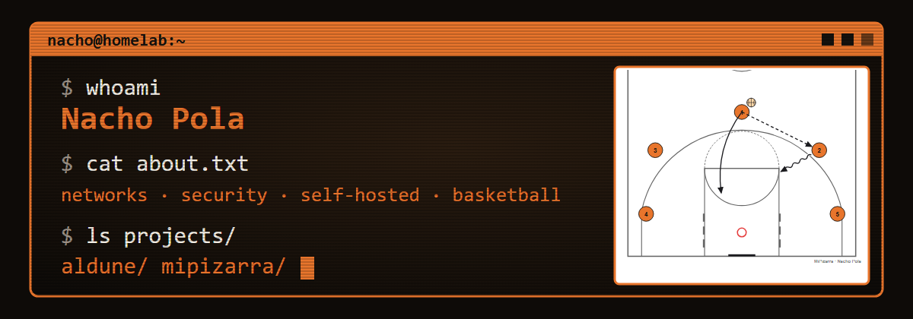

  <a href="https://nacho.polacabezon.com">Portfolio</a> ·
  <a href="https://linkedin.com/in/nacho-pola-304686304">LinkedIn</a>

## `$ cat about.txt` · English

I'm in my 4th year of the Telecommunications Engineering degree (Telematics) at the University of Zaragoza
(EINA), focused on networking and security. I like understanding systems by running them: at home I operate
a Proxmox server with a Wazuh SOC, SNMP network monitoring and a set of self-hosted services. Off the
keyboard, I coach youth basketball teams, which is where most of my project ideas come from.

### `$ ls projects/`

Both are open source and both started as tools I needed myself.

- **[Aldune](https://github.com/NachoPola16/aldune)**: sticky notes on the edge of your screen for Windows and Android.
  Password-protected notes (AES-256-GCM), automatic backups and optional end-to-end encrypted sync.
  C# / .NET, Kotlin. GPL-3.0.
- **[MiPizarra](https://github.com/NachoPola16/mipizarra)**: a basketball coaching assistant that runs on a 100% local LLM:
  Ollama + RAG (ChromaDB) + a deterministic SVG diagram renderer. Python, FastAPI, Django, Docker. AGPL-3.0.

### `$ cat stack.txt`

Networking (TCP/IP, SNMP, monitoring), network security, local LLMs (Ollama, LoRA fine-tuning, RAG), and
GitHub Actions for builds and releases.

---

## `$ cat sobre-mi.txt` · Español

Estudio 4.º de Ingeniería de Tecnologías de Telecomunicación (mención en Telemática) en la Universidad de
Zaragoza, con foco en redes y seguridad. Aprendo operando los sistemas: en casa tengo un servidor Proxmox con
un SOC con Wazuh, monitorización de red por SNMP y varios servicios autoalojados. Fuera del teclado, entreno a
equipos de baloncesto de formación, y de ahí salen casi todas mis ideas de proyecto.

- **[Aldune](https://github.com/NachoPola16/aldune)**: notas adhesivas en el borde de la pantalla para Windows y Android, con notas cifradas y sincronización opcional de extremo a extremo.
- **[MiPizarra](https://github.com/NachoPola16/mipizarra)**: asistente de entrenamiento de baloncesto con IA 100 % local (Ollama + RAG + diagramas SVG).

Issues y discusiones en mis repositorios son bienvenidos, en español o en inglés.
